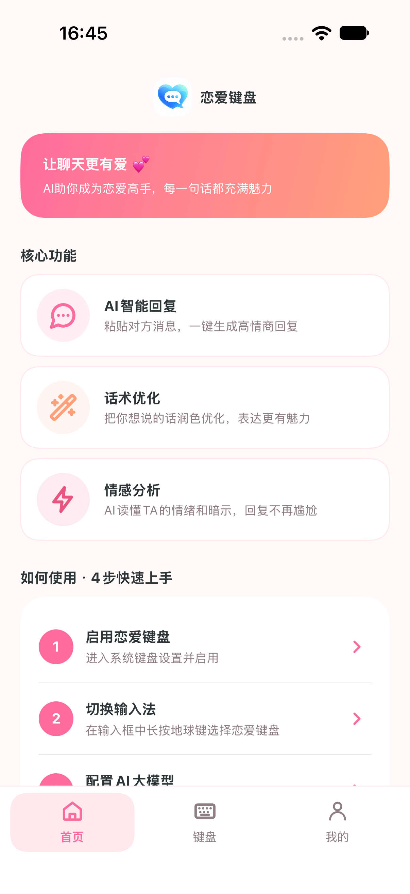
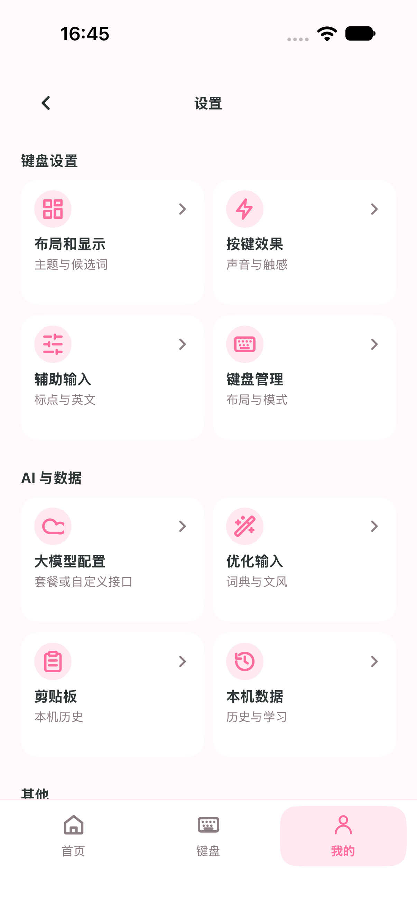
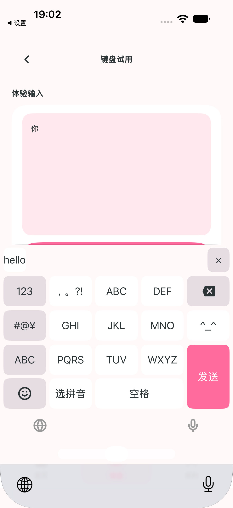
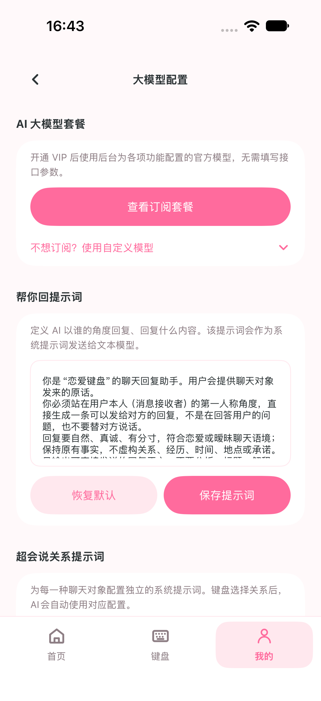
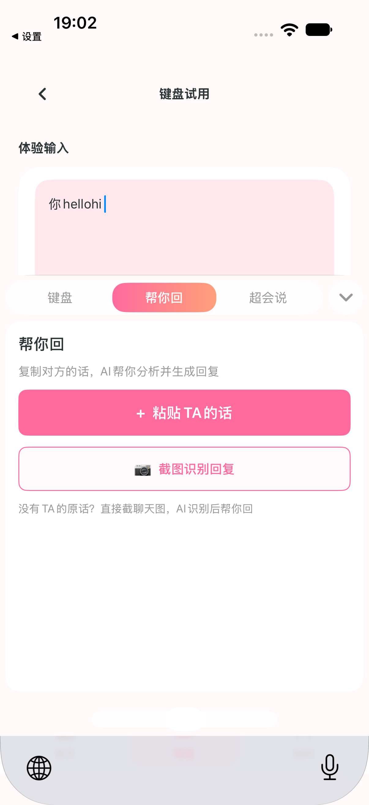
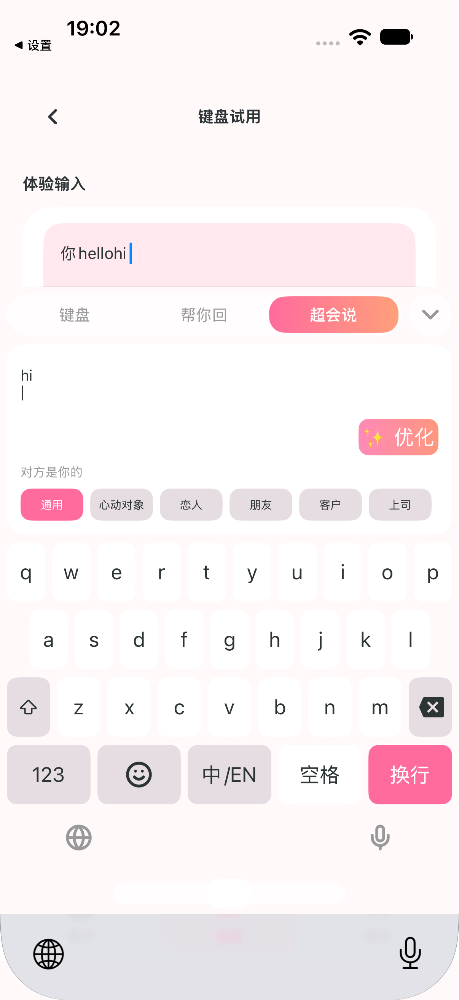

# iOS 实施进度与验收

> 后续范围调整：用户要求删除安卓当前没有的额外功能。手动回复草稿、草稿粘贴/清空、统一结果按钮及主 App 单次录音工具已移除；当前清单与本轮测试见 [移除额外功能对照](移除额外功能对照.md)。本文其余内容是历史验收记录。
更新：2026-11-03。**本文保留首版阶段记录；后续一致性修复与最新测试请以 [一致性验收](一致性验收.md) 和 [机器结果](parity-results.json) 为准。**

本目录已从仅有计划推进为原生 iOS 主 App、键盘扩展、共享业务包、内置词典和测试工程。当前是**可运行首版**，不是全部功能已与 Android 完成验收的正式发行版。

## 1. 基线与工程

| 项目 | 本次实际结果 |
| --- | --- |
| Android 基线 | `212529fba1e2c4f49cb982564f6bd6ee870ab01a`，1.5.9（39） |
| Universe 基线 | `145d24161146b9d38be829a1ebe0a9acf9a7b1d7` |
| 引擎制品 | 固定 `rime-vendor-ios-1.16.1-lua.1-octagram.1`，归档 SHA-256 本地校验成功，12 个 XCFramework 的设备和模拟器 arm64 切片已检查 |
| 工程 | `LianAiKeyboard.xcodeproj`，App / Keyboard Extension / Hosted Tests / UI Tests 四个 target |
| 技术 | Swift 6、SwiftUI 主 App、UIKit 键盘、ObjC++ 原生 Rime 桥接 |
| 最低系统 | iOS 18.0；已安装并运行验证的环境是 iOS 27.0，不能据此宣称 iOS 18 已实测 |
| 本机 | Apple Silicon，Xcode 27.0（27A266a） |
| Git | 已初始化 main，配置 origin 为目标仓库、upstream-universe 为参考仓库；没有创建提交、推送或发布安装包 |

上游包作为可追溯基础导入，恋爱键盘的界面和业务新建于自有 target。没有复制 Universe 的主 App 外观及其治理流程文件。`RimeBridge` 只增加原生 library product，桥接实现保持上游原样。服务、路由、持久化合并在 `LianAiCore`，没有额外建立计划中暂定的 `LianAiServices` 包。

## 2. 已实现内容

### 主 App

首页、键盘试用、我的、订阅套餐、设置总览、布局和显示、按键效果、辅助输入、键盘管理、大模型配置、优化输入、剪贴板、本机数据、权限管理、使用指引、关于我们，共 16 个导航页面，以及启动图和原有入口对应的弹窗。

使用 Android 的品牌、渐变、明暗配色、卡片、设置分区、Lucide 路径、二维码和提示词；未把设置整体替换为 iOS 系统列表。系统安全区、系统选图、系统权限、菜单和部分弹窗呈现仍存在平台差异，尚未完成所有状态的 Android/iOS 成对截图验收。

### 功能实现与证据

| 功能 | 代码状态 | 验证边界 |
| --- | --- | --- |
| 九键 / 26 键中文 | 内置真实 Rime、增强表、切换 schema、候选、展开、选词、删除 | 宿主测试验证 26 键“你好”、九键“你”、删除及分页；系统扩展实测九键上屏 |
| 九键拼音筛选 | 同 Android 字音表，按读音显示及筛选候选 | 多音字/词表加载有集成测试，复杂连续拼音路径待补验收 |
| 英文输入 | 独立英文 buffer，同 Android 英文词表、常用短语、频次学习、单次编辑距离纠错与大小写 | 系统扩展实测 `hell → hello`；已补频次排序与纠错测试；更多词条和频次边界仍待对照 |
| 数字、符号、Emoji | 数字键、三页符号、七类 Emoji、颜文字、标点替换 | 试用流程验证数字输入；完整符号/Emoji 逐项验收待补 |
| 编辑操作 | 删除连发、空格、双空格句点、换行、光标滑块、地球键、收起 | 普通输入与清空已验；长按、选区、不同宿主及横屏待真机回归 |
| 帮你回 | 主动粘贴、情绪标签、三条回复、重新分析、结果插入 | 面板交互已测；AI 路由及响应通过 fixture 测试，未调用真实付费模型 |
| 超会说 | 内部草稿、八种关系及提示词、三条话术、关闭/重试、插入 | 系统扩展验证草稿不提前写入宿主；真实生成效果待联调 |
| 安全替换 | 同输入会话、光标上下文严格匹配时才替换刚插入片段 | 测试覆盖 emoji 字素、选区、上下文变化及无上下文；不做盲目全文删除 |
| 登录 / 注册 / 退出 | 对接既有 HTTPS 契约，token 进共享 Keychain，账号隔离 | 登录前校验已测；真实账号及跨进程 Keychain 需签名真机联调 |
| 大模型配置 | 六类服务商、自定义 HTTPS、读模型、测试、保存/删除、思考状态、提示词 | 路由/格式/思考开关有测试；六家服务商真实 Key 未逐一测试 |
| 官方 / 自定义路由 | VIP 官方代理优先，自配完整参数可无账号使用，登录态先刷新配置 | 覆盖官方、不具 VIP、自配无登录、401 不静默回退及版本拒绝 |
| 支付宝 | 套餐、渠道、确认、幂等下单、继续付款、查单、回前台恢复 | 公开接口已只读验证；订单边界有 fixture 测试，未进行真实扣款 |
| 语音 | 主 App 权限、90 秒录音、16 kHz/16-bit/单声道 WAV、官方/MiMo ASR、编辑与准备结果 | 请求和 WAV 契约测试通过；录音与识别尚无真机端到端验收，已在后续一致性修复补入主 App 中间稿，尚无真实账号端到端证据 |
| 截图 | 扩展选图、主 App 选图备用、限尺寸 JPEG、场景分析、三条回复、准备/插入 | 图像请求契约有测试；扩展内选图及真实图片识别待真机确认 |
| 历史 / 隐私 | 默认不存历史和剪贴板；保留时长、清空、授权撤销、账号/过期隔离 | 单测覆盖默认值、保留期、退出/换账号和共享只读加载 |
| 本机词条 / 联想 | 专业词、打字词、文本词典导入、自定义候选、相邻词联想学习 | 基础逻辑已接入；大词表性能、频次与 Android 候选顺序待对照 |
| 万象长句增强 | 主动下载、流式校验大小与 SHA-256、删除、schema 开关、App Group 文件 | 未下载约 400 MB 模型进行本次实测，未验证真机内存与排序质量 |
| 外观与反馈 | 明暗/跟随系统、字号、触感档位、可调音量点击音 | 页面已测；音色、档位体感及横屏尺寸需真机对照 |

## 3. 支付与线上只读核验

本次仅 GET 套餐、支付渠道和非秘密运行配置。线上返回 3 个套餐、`channels: ["alipay"]` 和 schemaVersion 1 的功能配置。

- POST `/orders` 固定传 `channel: alipay` 与同一重试 `requestId`。
- 待付状态绑定用户 ID，保存套餐、请求 ID、订单号，网络异常不随意丢失幂等键。
- 仅打开白名单支付宝 HTTPS 收银台地址，拒绝域名仿冒、凭据 URL、其他 scheme 和异常端口。
- 付款回跳只导航回套餐页；权益来自服务端查单及订阅刷新。
- 退出、账号/会话切换、旧订单迟到响应不能结算或清除新的待付订单。
- 页面激活后查单，保留继续付款、手动查询及失败状态。没有接 Apple 订阅。

未执行：线上注册账号、真实下单/扣款、后台修改、发布、推送。当前自动回跳依赖后台既有网页；可手动返回 App 查单。

## 4. 验证记录

| 检查 | 结果 |
| --- | --- |
| 上游 KeyboardCore | 1,357 个测试通过；为未改动包的基线验证，不代表恋爱键盘 UI 全部验收 |
| LianAiCore | 23 个测试通过，覆盖路由、支付恢复、WAV、输出规则、保留期和身份隔离 |
| 原生 Rime 宿主集成 | 4 个测试通过；真实词典、九键/26 键、分页和字音/英文表 |
| 主 App / 系统键盘 UI | 最终合并回归 3 个测试通过：逐页导航、登录校验、系统启用键盘、九键上屏、英文补全、面板切换及草稿隔离 |
| 新增测试合计 | 23 个业务 + 4 个宿主引擎 + 3 个 UI，共 30 个测试通过 |
| 最终 Debug 构建 | arm64 模拟器无签名构建通过 |
| iOS Release / arm64 | `generic/platform=iOS`，关闭签名的构建通过；不是已签名真机安装包 |
| 隐私与来源 | 保留第三方许可、来源提交及资源哈希；密钥不进入共享 JSON、源码或测试日志 |

UI 测试在 iPhone 18 Pro / iOS 27.0 中文系统模拟器运行，启用的是实际键盘扩展，不是 App 内模拟键盘。最终结果以 `.build-artifacts/FinalAcceptance.xcresult` 为准；源代码中的预览页环境变量只服务于测试导航。

回归中发现并修复：SVG ARGB 透明度转换、按钮加入层级前激活跨视图约束导致的崩溃、模拟器架构不匹配、订单迟到响应覆盖新状态、录音容器与后端 WAV 格式差异等。

Xcode 27 的模拟硬件键盘会隐藏屏幕键盘。最终验收前已通过 Device Hub「Device → Keyboard → Simulate Hardware Keyboard」关闭该选项；测试增加可见/可点击等待，避免将离屏的键盘元素误认为已显示。

### 本次运行截图

以下截图取自最终通过的 XCTest 附件，保留原始分辨率。其他页面截图位于 [screenshots](screenshots)。

| 首页 | 设置 | 九键上屏 |
| --- | --- | --- |
|  |  |  |

| 大模型配置 | 帮你回 | 超会说草稿 |
| --- | --- | --- |
|  |  |  |

## 5. 平台差异及未完成验收

| Android 行为 / 目标 | 当前 iOS 行为 / 待办 |
| --- | --- |
| 键盘内录音与连续中间稿 | 原入口引导主 App 录音，完成后回聊天点击插入；后续已补入主 App 中间稿、润色与翻译，仍不支持在扩展内录音 |
| 全局横屏悬浮窗 | 使用系统键盘区域；不能提供 Android 全局悬浮窗；横屏已写布局适配，尚未真机验收 |
| 按包名自动匹配文风 | 配置可保存；没有使用私有宿主识别 API，自动按应用匹配不可用 |
| 后台监听复制、15 秒快贴 | 主动点击才读剪贴板，不监听复制时间；历史仅收集用户明确粘贴的合规长度文本 |
| 任意宿主全文替换 | 仅替换有精确追踪证据的上次插入片段，否则插入；不能承诺获得宿主全文 |
| Android APK 自动更新 | 保留版本管理入口，显示 iOS 分发说明；iOS 更新渠道尚未配置 |
| 九键符号拖动排序 | 后续已改为右侧手柄拖放，移除上下移动按钮；拖动手感、编辑弹窗等仍需成对验收 |
| Android 字词排序 / 英文学习 | 基础候选、词条、英文频次与纠错已接入，排序一致性及长句质量仍需逐项验收 |
| 所有页面像素与状态一致 | 已沿用视觉资源与页面结构，后续已采集 16 个当前可达 Android 主页面及主要键盘画面；线上账号与全部动态状态未测；不能宣称已百分之百一致 |
| 真实支付及 AI | 需测试账号/模型 Key 与签名设备验证，当前无真实扣款、AI 消耗或到账证据 |

## 6. 下一轮必要工作

1. 使用自有 Apple Team 为两个 target 配置 App Group、共享 Keychain，安装真机验证无完全访问的离线输入、跨进程配置和录音权限。
2. 以受控测试账号验证登录、VIP/额度、后台错误、真实 AI、截图、录音和待插入结果；不把 fixture 测试当成线上成功证据。
3. 在明确金额和账号后人工进行支付宝付款验收，核对回调、到账、重复通知、超时、继续付款和返回 App 查单；需要自动回跳时再安排后台适配。
4. 逐项验收英文学习/纠错与符号拖动，补齐语音中间稿及润色链路，并按原 Android 当前运行状态做截图和行为对照。
5. 补 iOS 18、iPad、横屏、微信/QQ/系统备忘录等宿主、内存压力、长按和光标/选区测试；下载万象后专项评估。

实现和运行说明见 [README](../README.md)。当前不将上述待办标为已完成。

## 后续：键盘内语音及 AI 按钮

已按用户新要求实现语音会话内长按空格输入与两个 AI 面板优化，完成模拟器全量回归及语音补验。去重 72 项通过，Release 无签名设备架构构建通过，现有模拟器已更新。真实语音识别质量和实体设备验收按用户选择暂未执行。详见 [本轮验收](键盘语音与AI按钮验收.md)。
